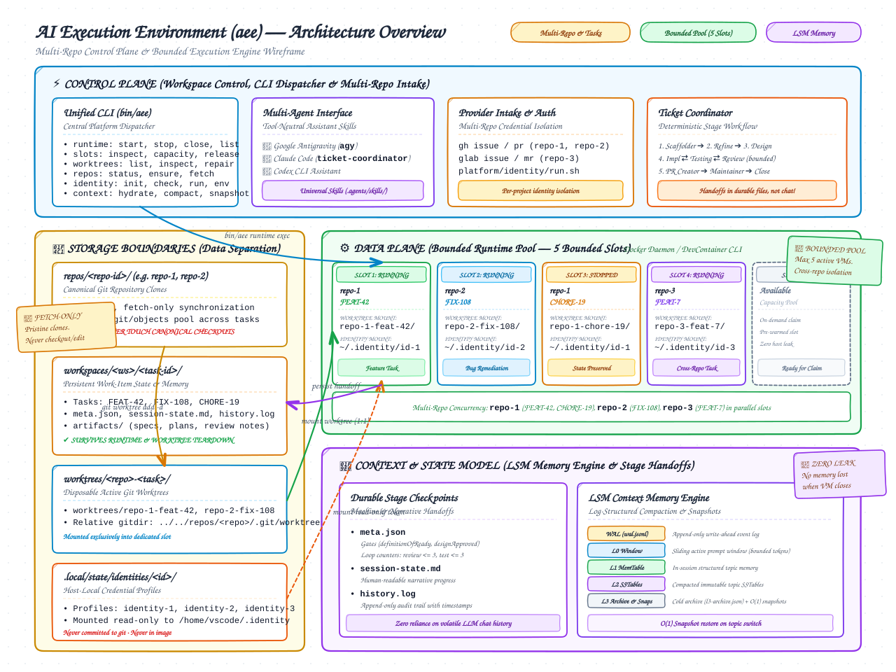
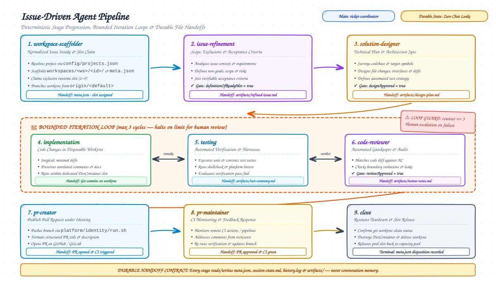

# AI Execution Environment (`aee`)

An issue-driven workspace control plane and multi-agent execution platform across independent personal projects.

`aee` provides strict boundary isolation between canonical code checkouts, durable work-item memory, and disposable execution worktrees. Each active worktree receives an exclusive container from a bounded runtime pool with project-isolated credentials.

---

## Architecture Overview

The system strictly decouples the **Control Plane** (agent orchestration, issue intake, and CLI tooling), the **Data Plane** (containerized runtimes and toolchains), the **Storage Boundaries** (repositories, persistent workspaces, and disposable worktrees), and the **Context & State Model** (durable stage checkpoints and an LSM-tree context memory engine).



> *Looking for the high-density technical schematic? See [`documentation/assets/aee-architecture.svg`](documentation/assets/aee-architecture.svg).*

### System Components & Interactions

| Architectural Domain | Responsibilities & Components |
|---|---|
| **Control Plane** | • **Unified CLI (`bin/aee`)**: Central command dispatcher for runtime, slots, worktrees, repos, work-items, identities, and context.<br/>• **Agent Interfaces**: Native integration with Google Antigravity (`agy`), Claude Code subagents, and Codex.<br/>• **Ticket Coordinator & Pipeline**: Deterministic stage workflow (`scaffolder` ➔ `issue-refinement` ➔ `solution-designer` ➔ `implementation` ⮂ `testing` ⮂ `code-reviewer` ➔ `pr-creator` ➔ `pr-maintainer` ➔ `close`).<br/>• **Provider Intake**: Adapters for GitHub (`gh`) and GitLab (`glab`) ticket and PR operations wrapped by credential isolation. |
| **Data Plane**<br/>*(Execution Engine)* | • **Host / Execution VM**: Boundary containing the Docker daemon and Dev Container CLI (`@devcontainers/cli`).<br/>• **Bounded Runtime Pool**: Fixed-capacity container pool (`RUNTIME_POOL_SIZE`, default: 5 slots).<br/>• **Exclusive Container Slots**: Each active worktree claims an exclusive container; pausing preserves state, closing destroys the container and worktree.<br/>• **Credential Isolation**: Only the work item's assigned identity profile is mounted read-only into `/home/vscode/.identity`. |
| **Storage Boundaries** | • **`repos/<project>/`**: Canonical Git clones; pristine, fetch-only synchronization, provides the common `.git` object directory.<br/>• **`workspaces/<ws>/<ticket>/`**: Durable work-item records outliving container and worktree lifecycles.<br/>• **`worktrees/<ws>-<ticket>/`**: Flat disposable checkouts branched from `origin/<default>` using relative Git administrative links.<br/>• **`.local/state/identities/<id>/`**: Host-local credentials, never committed to Git or baked into container images. |
| **Context & State Model** | • **Pipeline Stage State**: Coarse-grained machine state (`meta.json`), narrative checkpoint (`session-state.md`), append-only audit trail (`history.log`), and deliverables (`artifacts/`).<br/>• **LSM-Tree Context Memory Engine**: Write-Ahead Log (`wal.jsonl`), L0 sliding prompt window, L1 in-session MemTable, L2 compacted SSTables (`l2-sstables/`), L3 cold archive (`l3-archive.json`), and $O(1)$ point-in-time topic snapshots (`snap-*.json`). |

---

## Core Boundaries & Persistence Model

The workspace enforces three strict separation boundaries to ensure that human workflows, agent modifications, and credentials never cross-contaminate. The runtime pool concurrently isolates tasks across independent repositories (`repo-1`, `repo-2`, `repo-3`) as well as multiple distinct tasks within the same repository (`repo-1 / FEAT-42` alongside `repo-1 / CHORE-19`):

```text
repos/repo-1/                                   canonical clone (pristine, fetch-only)
workspaces/team-repo-1/FEAT-42/                 persistent work-item memory (survives disposal)
worktrees/team-repo-1-feat-42/                  disposable checkout (exclusive container slot)
.local/state/identities/identity-1/             isolated credential profile (host-local)
```

1. **Canonical Checkouts (`repos/`)**:
   - Checkouts under `repos/` represent the source of truth on disk.
   - Platform synchronization is fetch-only: it updates remote-tracking refs and `origin/HEAD` but never checks out, merges, resets, or touches the canonical working tree.
2. **Persistent Workspaces (`workspaces/`)**:
   - Each ticket has its own directory under `workspaces/<workspace-id>/<work-item-id>/`.
   - Stores durable handoff artifacts (`artifacts/`), loop counters and gate statuses (`meta.json`), narrative progress (`session-state.md`), and the topic-partitioned context memory tree.
   - Retained permanently after the runtime container and worktree are destroyed.
3. **Disposable Worktrees (`worktrees/`)**:
   - Flat directories directly below `worktrees/` branched explicitly from `origin/<default>`.
   - Never branched implicitly from the canonical checkout's current `HEAD`.
   - Created with relative Git administrative paths and mounted exclusively into the container runtime.
4. **Identity Isolation (`.local/state/identities/`)**:
   - Host-local profiles define authentication tokens, Git user identities, and provider CLI configs.
   - Commands are executed strictly through `platform/identity/run.sh`. Tokens are never shared across profiles or baked into images.

---

## Issue-Driven Agent Pipeline

A ticket progresses through discrete, bounded workflow stages. Each stage has a single responsibility and durable file handoffs, preventing dependence on volatile conversation memory:



- **`workspace-scaffolder`**: Resolves issue source, initializes `meta.json`, scaffolds durable workspace directory, claims pool slot, and starts runtime worktree.
- **`issue-refinement`**: Analyzes ticket requirements, sets acceptance criteria, and generates `artifacts/refined-issue.md`.
- **`solution-designer`**: Crafts technical approach, file targets, and trade-offs in `artifacts/design-plan.md`.
- **`implementation` ⮂ `testing` ⮂ `code-reviewer`**: Bounded iteration loop for writing code, running test harnesses, and performing automated peer reviews. Loop counters prevent infinite cycles.
- **`pr-creator` / `pr-maintainer`**: Pushes the branch, opens the pull request using the project identity, and monitors CI checks.
- **`close`**: Confirms clean git status, releases container slot, tears down the worktree, and records final disposition (`merged` or `abandoned`).

### Multi-Agent Interoperability

Platform skills are tool-neutral and synchronized identically across all supported AI assistants:
- **Google Antigravity (`agy`)**: Loaded via `.agents/skills/`.
- **Claude Code**: Loaded via `.claude/skills/` and stage subagents in `.claude/agents/`.
- **Codex**: Loaded via `.codex/skills/`.

---

## Unified CLI Reference (`bin/aee`)

The unified CLI provides command-line control over all platform subsystems:

```bash
aee <command> [subcommand] [arguments...]
```

| Command | Subcommands | Purpose |
|---|---|---|
| **`runtime`** | `start`, `stop`, `close`, `list`, `slots`, `worktrees` | Manage container runtimes, inspect pool allocations, and operate worktrees. |
| **`slots`** | `list`, `inspect`, `resize`, `recreate`, `release` | Shortcut for container-pool slot inspection, capacity changes, and slot release. |
| **`worktrees`** | `list`, `inspect`, `repair`, `prune` | Shortcut for worktree health inspections, path repair, and stale worktree cleanup. |
| **`repos`** | `status`, `ensure`, `clone`, `fetch` | Inspect canonical checkouts, fetch upstream refs, and register repositories. |
| **`work-items`** | `list`, `scaffold`, `status` | Scaffold work items from issue providers, inspect status, and manage lifecycles. |
| **`identity`** | `list`, `init`, `check`, `env`, `run` | Initialize credential profiles, verify CLI authentication, and wrap provider executions. |
| **`context`** | `init`, `hydrate`, `append`, `compact`, `snapshot` | Operate the LSM context memory model, hydrate prompt windows, and switch topic snapshots. |
| **`setup`** | `plan`, `apply` | Preview and materialize host setup configurations. |
| **`doctor`** | — | Run comprehensive health and dependency diagnostic checks across host tools. |
| **`validate`** | — | Verify platform integrity, shellcheck scripts, and validate manifests. |

---

## Quickstart & Workflow Walkthrough

### 1. Pre-Flight Setup

Preview setup requirements without changing host environment:

```bash
./bin/aee setup plan --mode devcontainer --provider github --interface codex
```

After reviewing the trust boundaries and credential isolation policies, materialize the profile:

```bash
./bin/aee setup apply --mode devcontainer --provider github --interface codex
```

### 2. Configure Identity Profile

Create and authenticate an isolated identity profile for your Git and issue provider:

```bash
# Initialize isolated profile
./bin/aee identity init personal --mode isolated

# Authenticate provider CLI under the profile
./platform/identity/run.sh --identity personal -- gh auth login

# Verify credentials
./bin/aee identity check personal
```

### 3. Register a Project

Add project configurations to `config/projects.json`:

```json
{
  "version": 1,
  "projects": [
    {
      "id": "my-project",
      "workspace": "personal-my-project",
      "repository": {
        "provider": "github",
        "owner": "my-org",
        "name": "my-project",
        "url": "https://github.com/my-org/my-project",
        "path": "repos/my-project",
        "identity": "personal"
      },
      "issues": {
        "provider": "github",
        "owner": "my-org",
        "repository": "my-project"
      }
    }
  ]
}
```

Validate the manifest:

```bash
./bin/aee validate
```

### 4. Scaffold a Work Item

Create a new work item from an upstream issue:

```bash
./bin/aee work-items scaffold personal-my-project 42 --type FEAT
```

This ensures the canonical checkout under `repos/my-project`, branches `feat/42-issue-title` from `origin/<default>`, allocates an available container pool slot, mounts the disposable worktree and identity profile, and starts the runtime container.

### 5. Execute Pipeline Stages

Advance the work item through the agent pipeline:

```bash
# Antigravity / agy
agy "Resume work on TASK-42 using the ticket coordinator"

# Claude Code
claude --agent ticket-coordinator

# Or manage container runtimes directly
./bin/aee runtime list
```

### 6. Clean Closure & Teardown

After opening the pull request and merging changes:

```bash
./bin/aee runtime close personal-my-project FEAT-42 --reason merged
```

This verifies that the worktree is clean, unmounts and removes the container, destroys the disposable worktree, releases the pool slot back to the capacity pool, and marks the work item terminal state in `workspaces/personal-my-project/FEAT-42/meta.json`.

---

## Verification & Platform Maintenance

- **Validate Platform**:
  ```bash
  ./bin/aee validate
  ```
  Runs ShellCheck across all platform scripts, verifies project manifests, and checks skill consistency.

- **Synchronize Portable Blueprint**:
  ```bash
  ./architecture/sync-scaffold.sh
  ```
  Keep the synchronized generic blueprint under `architecture/scaffold/` aligned with the tracked platform implementation.

- **Architecture Documentation Deep Dives**:
  - [`architecture/runtime-lifecycle.md`](architecture/runtime-lifecycle.md): Pool sizing, container lifecycle, and worktree repair.
  - [`architecture/identity-model.md`](architecture/identity-model.md): Host vs isolated profiles, token containment, and environment security.
  - [`architecture/context-memory-model.md`](architecture/context-memory-model.md): Detailed LSM sliding window, WAL compaction, and snapshot algorithms.
  - [`architecture/pipeline-and-agents.md`](architecture/pipeline-and-agents.md): Stage gates, loop counters, and cross-agent coordination contracts.
