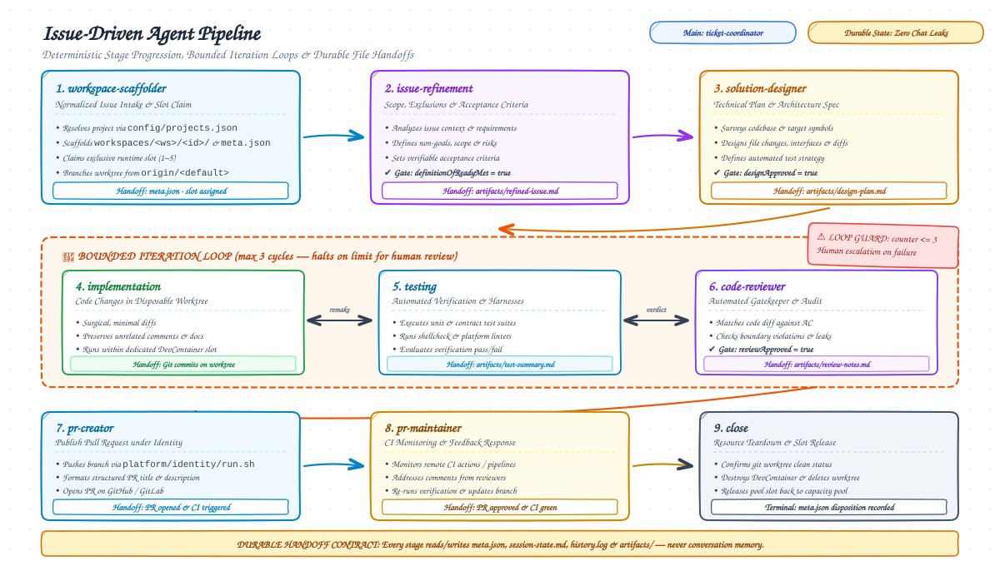

# Pipeline and agents

The tool-neutral definitions are under `platform/workflows/agents/`, and
assistant skills are provided under `.agents/skills/` (for Antigravity / `agy`),
`.codex/skills/` (for Codex), and `.claude/skills/` (for Claude Code); the
`SKILL.md` files must be identical across all three. Claude Code also loads
`CLAUDE.md`, which imports `AGENTS.md`, and `.claude/settings.json`, which denies
access to credentials and canonical checkouts and routes outbound Git and
pull-request commands through `platform/interfaces/claude/hooks/` for approval.
Each stage is also exposed as a generated Claude Code subagent in
`.claude/agents/`. These are thin wrappers that point to the stage definition,
with a tool allowlist and a hook limiting file edits to the roots that stage
owns. `claude --agent ticket-coordinator` runs the coordinator as the main
session, delegating to the stage subagents.

The coordinator is not a stage: it reads persistent state, reports the current
position, and advances only when explicitly asked to run headlessly.

Each stage has one bounded responsibility and one durable output. Refinement
produces scope and acceptance criteria; design produces an executable plan;
implementation commits project changes; testing records verification; review
records a verdict; PR stages publish and maintain the change. Failed testing or
review returns to implementation through bounded loop counters. Reaching a
limit blocks the item for human intervention rather than looping indefinitely.

Every handoff updates global state and the narrative checkpoint. Conversation
history is never treated as workflow memory.
